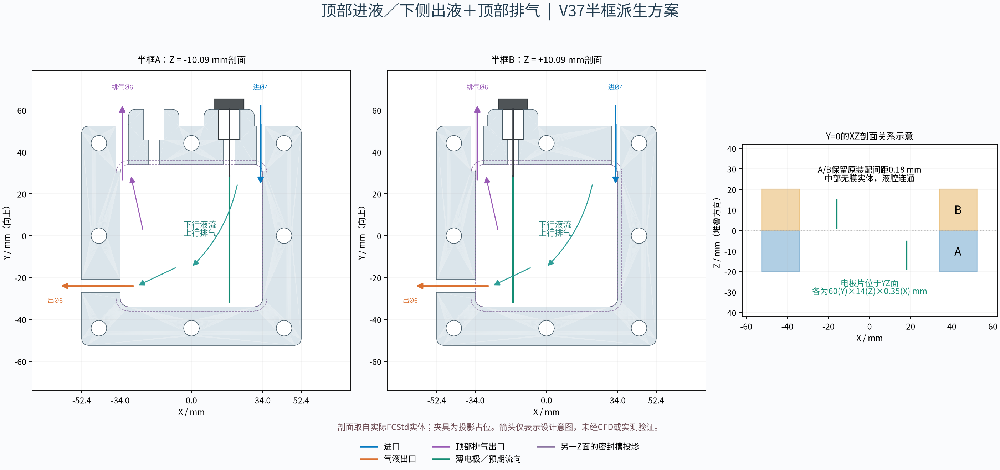
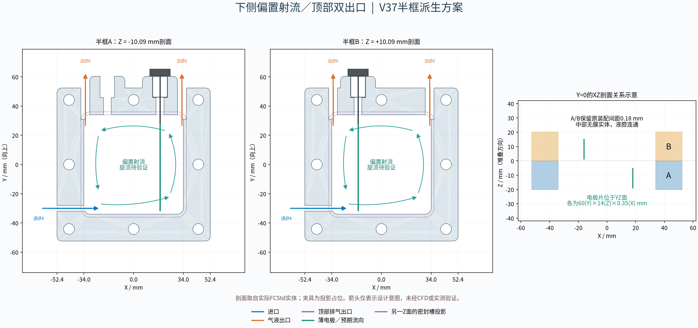
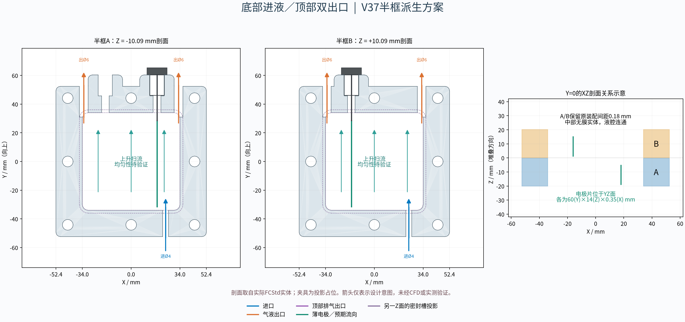
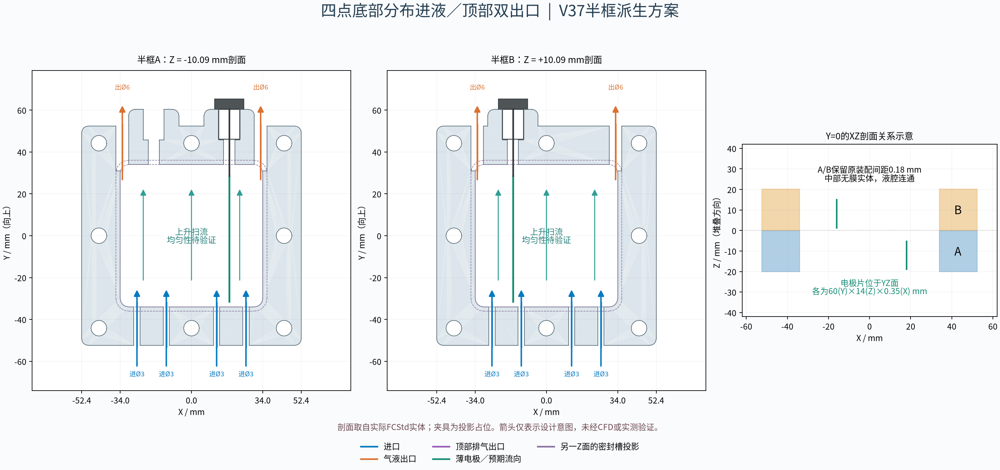

# 半框电解槽进出液布局研究（四版，未验证）

本目录提供 **1套FreeCAD重建基准＋4版独立派生方案**。每套均有真实BRep实体的 `.FCStd` 和 `.step`；四版另有中文剖面示意PNG。所有预期流型、流量均匀性、排气效果和尺寸适用性均未经CFD或实测验证，**不作承压或密封承诺，不是加工放行图**。

## 先核对设计来源

| 仓库来源 | 实际结构 | 与本任务的关系 |
| --- | --- | --- |
| `CAD_v2/README.md`、`CAD_v2/scripts/model_flow.py` 的B1 | 150×150×6框体、50×50工作窗、两个轴向Ø8内部歧管和埋入Ø2.2支路，正常供回液在前端 | 不是half_frame A/B，没有本任务所述顶部M12柱状夹具接口，未将它改造成半框 |
| `reference/Kolbe_v37_enlarged_parametric.scad` | 参数化半框，默认104.7外壳、86窗、四角螺栓，顶部电极插口 | 符合半框家族，但不是本次选用的八孔修订 |
| [`reference/Kolbe_v37_104p7_shell_68_chamber_8bolts_centered_ports_shifted.scad`](../../reference/Kolbe_v37_104p7_shell_68_chamber_8bolts_centered_ports_shifted.scad) | 104.7外壳、68窗、八个Ø7.5螺栓孔、A/B各20厚；A两个顶部电极插口，B一个 | **本目录的几何基准**，接口移位已避让顶部中央螺栓 |

**仓库没有完全符合“半框＋柱状夹具实体＋薄片＋底进侧出”的现成设计。** 两份reference半框SCAD都有电极插口及薄片/导电杆示意，但没有独立的底部进液孔或侧面出液孔，也没有柱状夹具本体的真实详图。B1的上下埋入支路通往前端接口，不能据此称其为该半框的“底进侧出”。用户所述实物可能另有后加工孔，但仓库无法证实。本目录新增流体孔，未把它们谎称为原有孔。

生成器用FreeCAD Python的解析圆弧、拉伸、布尔切削重建半框，不以STL转实体。独立调用原始SCAD的 `half_frame_A/B` 模式导出网格，比较体积、包围盒，结果写入 `geometry_checks.json`。SCAD圆周为96段，FreeCAD为精确圆弧，所以允许小量离散误差；这种比较是整体一致性核对，不是每一表面的全场误差证明。

## 基准保留与示意边界

- 坐标：XY为半框大面，**+Y向上**，Z为堆叠厚度。A中心Z=−10.09，B中心Z=+10.09；各半框局部厚度Z=−10～+10，保留源码0.18装配间距。
- 半框主体104.7×104.7、外角R3；液腔68×68、R4；顶部原有24×12、R3插口加高座保留。八孔中心为四角(±44.175,±44.175)及四边中点(±44.175,0)、(0,±44.175)，孔径Ø7.5。
- 密封环槽宽2，标称深0.50；按源码 `zc=±9.77, height=0.58` 的实际布尔范围重建，**切入实体为0.52**，并非擅自改深。A槽在+Z，B槽在−Z。源文件中的旧尺寸注释不作为尺寸依据。
- 电极插口沿−Y向下：A的局部(X,Z)=(-18,+2)、(+18,−2)，B=(-16,−2)；顶部Ø10.6攻丝预孔区间Y=60.75～45.75，Ø6.65缩颈至Y=32。源码没有真实螺纹，本模型也不建螺纹，M12×1.5只是原设计意图。
- 两片电极忠实对应当前 `cross_electrode_under`：**60(Y)×14(Z)×0.35(X)**，片顶Y=28.5、片底−31.5；位于YZ平面。A用X=+18、B用X=−16，均局部Z=−2，Ø3导电杆Y=27.5～60.6。源码注释中的“30高”和“5 mm间距”已过时；当前电极X向相隔34，不能据此宣称已具备理想电化学净距。
- **新增柱状夹具只作占位**：Ø10.2筒身Y=46.15～60.35、Ø14肩部Y=60.35～65.35、Ø3.2轴孔。尺寸来自本次示意选择，不是实测件，也不声称还原了夹紧、电连接、螺纹或密封细节。四版和基准使用完全相同的夹具、电极及导电杆。
- 按用户无隔膜体系要求不放膜实体；源码的0.18间距仅作为原装配定位保留。周边垫片、两外侧封闭板、紧固件、管件和未用A旧插口的堵头不在本目录实体中；该模型本来就是开放的半框研究组件，**不能直接灌液使用**。原有密封面和槽完整保留，实际垫片堆叠与封闭边界仍需另行确定。

## 常见流路的简要调研

下表将文献中的结构思路与本几何的工程推断分开；文献结果不能直接外推为本槽的性能。

| 布局 | 设计思路与适用性 | 对本Kolbe半框的推断与风险 |
| --- | --- | --- |
| 顶部进液、下部回液 | 向下冲洗或重力辅助供液，安装方向是一个设计变量 | 下行液流与气泡浮升相逆；必须保留顶部气液排出口，避免上部气塞；顶部进口也可能直接短路到排气口 |
| 侧面切向/偏置进液 | 圆筒电化学反应器已有切向入口促进传质的研究[1] | 方形68窗和两片竖直薄片会打断旋转；本次只实现沿下缘的偏置射流，可能形成回流，也可能仍有角部死区 |
| 多孔分布板 | 通过孔阵列和一定的分配压降降低入口射流偏流；分配板也可采用缩口与扩散段[2] | 易堵、压降增加、板下积气或积料；需比较配液压降与孔口压降。为了保持液腔不变，本次**不加板、不加腔内挡板**；多点进液不是多孔板的等价验证 |
| 多点分布式进液 | 分布式注入已有无隔膜微反应器实例，可减少复杂内部分配器[3] | 用独立底孔覆盖更宽区域；需外部等阻/可调供液，否则每点分流量不相等，且增加接口漏点和清洗工作 |
| 底进顶出 | 使主流和气泡浮升同向；无隔膜电解槽已有由下向上的气泡流可视化实验[4] | 适合作为本次冷态比较的起点，但低速角部滞流、电极背后滞留、气液分配不均仍可能出现 |

Kolbe阳极羧酸盐氧化、脱羧后生成CO₂并形成偶联烷烃；阴极通常析H₂。短链烷烃可能为气体，长链产物可为液体，不能把所有烷烃都按气体计算。连续Kolbe微反应器研究也显示CO₂与碱液反应导致碳酸盐累积，对循环过程产生影响[5]。因此本研究保留顶部气液出口，避免把唯一出口置于低位；下游气液分离、H₂/烃类混合气处置、泡沫与背压需结合实际物料另行设计。流道几何本身不能证明无死区或完全排气。

参考文献（检索日期2026-11-03，引用原始研究/专利；本模型参数为本次设计选择）：

1. Contigiani等，*Local mass-transfer study in a decaying swirling flow electrochemical reactor under single-phase and two-phase (gas-liquid) flow*，Chemical Engineering Journal 350 (2018) 233–239，[DOI](https://doi.org/10.1016/j.cej.2018.05.181)，[作者机构全文](https://ri.conicet.gov.ar/bitstream/handle/11336/84955/CONICET_Digital_Nro.c6d170fc-44e7-4e1c-b887-4f29c365eee3_A.pdf?isAllowed=n&sequence=2)。研究为圆柱构型，不支持本方形腔性能增益的数值推断。
2. Toomey，*Filter press electrochemical cell with improved fluid distribution system*，[US4589968A](https://patents.google.com/patent/US4589968A/en)。其分配板采用限流与扩散段；作为结构原理参考，不代表本目录孔阵列已实现均匀分配。
3. Laudadio等，*Design and application of a modular and scalable electrochemical flow microreactor*，J Flow Chem 8 (2018) 157–165，[开放全文](https://pmc.ncbi.nlm.nih.gov/articles/PMC6404740/)。文中分布式注液方式支持多点入口思路，不代表可以直接移用其尺度和操作条件。
4. *Framework for evaluating the performance limits of membraneless electrolyzers*，Energy Environ. Sci. (2020)，[原始研究及Fig.2](https://pubs.rsc.org/en/content/articlehtml/2020/ee/d0ee02268c)。体系为水电解，排气方向可借鉴，反应条件和气泡特性不同于Kolbe。
5. Baumgarten等，*Continuous Kolbe Electrolysis Using an Electrochemical Microreactor, Product Separation, and Electrolyte Recycling*，Chem. Ing. Tech. 96 (2024) 789–800，[原始研究](https://onlinelibrary.wiley.com/doi/10.1002/cite.202300109)。用于Kolbe产物与循环物料背景，不作为本槽流型证据。

## 四版模型与接口表

以下坐标均为**单半框局部坐标**；A/B采用相同的流体孔，装配时Z再分别加−10.09/+10.09。所有新增孔轴线局部Z=0，均为光孔示意，不新增外凸接头或螺纹。入口/出口的外侧轴线起点有少量超出实体以保证切穿；实际外口在主体边缘X或Y=±52.35处。

| 方案与文件（同名另有STEP及PNG） | 每半框进口 | 每半框出口 | 预期流型、优点与风险（全部未验证） |
| --- | --- | --- | --- |
| [inlet_top.FCStd](inlet_top.FCStd) | 顶部X=+33，沿−Y，Ø4；轴线Y=53→31 | 左侧Y=−24，沿−X排液，Ø6（孔轴X=−53→−32）；顶部X=−33沿+Y排气/排液，Ø6（孔轴Y=53→31） | 顶入下行扫流，顶部独立出口释放浮升气体；下侧口便于观察回液。顶进口至顶部出口可能短路，下行流与上浮气泡冲突，底角可能滞留；两出口阻力不同会影响分流，不能把顶部口封死 |
| [inlet_tangential.FCStd](inlet_tangential.FCStd) | 左侧Y=−30，沿+X，Ø4；轴线X=−53→−30 | 顶部X=−33、+33两孔，沿+Y，均Ø6；孔轴Y=53→31 | 入口靠下边缘形成偏置射流，研究循环混合和上部排气。方腔没有圆筒的严格切向定义；电极片可能使回流破碎、造成短路流或背面死区，不能保证形成稳定旋流 |
| [inlet_bottom_top.FCStd](inlet_bottom_top.FCStd) | 底部X=+24，沿+Y，Ø4；轴线Y=−53→−32 | 同上，顶部X=±33两孔Ø6 | 气液同向上行，接口较少，可作初始比较方案。单侧供液可能导致偏流、远侧角部和电极背面交换不足，双出口也需要匹配外部阻力 |
| [inlet_multipoint.FCStd](inlet_multipoint.FCStd) | 底部X=−26、−12、+12、+26四孔，沿+Y，均Ø3；孔轴Y=−53→−32 | 同上，顶部X=±33两孔Ø6 | 分散上升射流以覆盖底部宽度；保留液腔、无需内置分布板。需外部供液网络等阻或逐路调节；小孔易堵、清洗困难，连接点更多。外部分配管不在本次范围内，不声称已均匀进液 |

每个方案都是独立的新半框，**不能在同一零件上把四版孔全部打上**。每版A/B必须都有供回液，整套顶进、偏置、底进顶出分别为2入口+4出口，多点版为8入口+4出口；顶部排出口均为气液共用，没有内置气液分离。若实际采用单侧接口，需重新设计和验证，不应直接省略另一半框的管路。

顶部孔位于圆角附近；即使高位开口，局部最高处仍可能残留气袋，需要实际姿态下观察。出口与下游管路的连续上升关系也会影响排气，不能仅凭“顶出”认定完全自排气。






PNG中A/B的XY剖面来自交付FCStd实体；紫色虚线仅为另一Z面的密封槽投影，孔道从槽下穿过实体壁，没有切断槽。XZ小图解释薄片方向、双半框与无隔膜关系。箭头仅示意，不是流线计算。

## 几何检查、文件与复现

`generate_variants.py` 直接执行以下断言；任一失败即停止，完整数值见 [geometry_checks.json](geometry_checks.json)：

1. A/B均为有效单连续实体；派生体是原体减去圆柱孔，无新增框体材料；对称差限定在指定孔道内。
2. 两个宽面各0.6 mm保护层（覆盖密封面、槽底）切除体积为0，液腔及槽以外的原有结构不作调整。
3. 流体孔与密封槽、八个螺栓孔、原电极插口的BRep最近距离，以及厚度方向余壁均不小于**3 mm**；各独立流体孔之间余壁也不小于3 mm。该值是本次几何筛选门槛，没有材料强度依据，不是承压结论。沿轴线另取101点检查未指定外壁的余量；不构成任意曲面的全局最薄壁分析。
4. 每孔同时切到主体并进入液腔，孔内无剩余实体，孔口完整截面在实体外，且终点在腔内；与电极片、导电杆、柱状夹具无实体交叠。源码导电杆与薄片局部相交是原有连接示意，不当作接触机构验证。
5. `.FCStd`保存后关闭重开；STEP独立重读，检查有效性、8个实体、体积和几何往返。八实体为两个半框、两片薄片、两根杆、两个示意夹具；只导出最终实体，隐藏的原始半框历史不重复导出。
6. 原SCAD独立生成STL用于基准比对；STL是临时检查输入，不参与FreeCAD建模，不交付为替代实体。

本次实际结果：A/B相对原SCAD网格的最大体积差约 **0.00387%**，包围盒最大差约0.00000153 mm。四版新增孔到密封槽、螺栓孔、电极插口的全套最小距离分别为 **6.48、4.425、6.833 mm**，到宽面的余壁至少7 mm；完整外孔口检查通过。以上只是名义几何，不含攻丝后牙底、管接头扩孔、打印/加工公差或装配变形。

原生文件树含“原始半框”与“仅切除进出口孔道”两个BRep特征及设计记录；它不是逐一可驱动尺寸的Sketch/Pad历史。修改尺寸请编辑生成器后重建，或在FreeCAD中另建特征；仅改属性文字不会驱动几何。检查文件保存源码SHA256用于追溯。

目录内容：

- `baseline_half_frame.FCStd/.step`：含相同电极及夹具示意的基准，无新增流体孔。
- `inlet_top`、`inlet_tangential`、`inlet_bottom_top`、`inlet_multipoint`：各有 `.FCStd`、`.step`、`.png`。
- `generate_variants.py`：重建、派生、独立SCAD比对、原生/STEP检查。
- `render_schematics.py`：从最终原生文档提取剖面并画中文箭头。
- `style_models.FCMacro`：可选GUI外观处理，保存半透明框体及电极颜色，不改变几何。
- `verify_delivery.py`、`delivery_checks.json`：最终文件独立重读；对照基准确认电极/导电杆/夹具相同，仅指定孔道发生变化，并记录交付CAD/PNG的SHA256。
- `appearance_status.json`：GUI外观处理结果。
- `port_layouts.json`：生成器使用的精确孔道轴线和孔径表。
- `geometry_checks.json`：实际运行的检查结果，不能视为流体、材料或密封验证。

本次环境为Debian 13、FreeCAD 1.0.0、OpenSCAD 2021.01、Python 3.13。初始没有FreeCAD；已安装Debian的 `freecad-python3` 及所需库。该环境apt的HTTPS获取失败，改用curl获取同一Debian源的软件包并按索引SHA256核对后以dpkg安装；没有以空文件或改扩展名冒充CAD。

常规Debian安装与运行：

```bash
sudo apt-get update
sudo apt-get install -y freecad-python3 openscad python3-matplotlib fonts-noto-cjk
PYTHONPATH=/usr/lib/freecad-python3/lib /usr/bin/python3 CAD_v2/inlet_variants/generate_variants.py
PYTHONPATH=/usr/lib/freecad-python3/lib /usr/bin/python3 CAD_v2/inlet_variants/render_schematics.py
KOLBE_VARIANTS_DIR="$PWD/CAD_v2/inlet_variants" xvfb-run -a freecad CAD_v2/inlet_variants/style_models.FCMacro
PYTHONPATH=/usr/lib/freecad-python3/lib /usr/bin/python3 CAD_v2/inlet_variants/verify_delivery.py
```

也可使用其他已安装FreeCAD的Python环境；需要能导入 `FreeCAD`、`Part`、`PartDesign`、`Mesh`，并能调用 `openscad`。绘图需要matplotlib/numpy及中文字体，字体路径可在脚本内调整。模型不依赖原CAD_v2装配的外部链接，不改动B1零件。未执行push。

GUI外观处理可在FreeCAD中直接运行该宏；无显示服务器时使用上述 `xvfb-run`（需 `xvfb`、`xauth`）。本次交付已执行宏并保存外观。重建脚本只保存几何，重建后若需要相同外观应再运行宏，最后运行独立文件校验更新SHA256。

## 后续实测需要回答的问题

首先确定真实电极/夹具尺寸、膜间隙处的周边垫片、外侧封闭边界、液体组成/黏度、流量和电流产气量，再做透明冷态染色与排气观察，检查电极背面及四角的驻留，测压降和多点分流。随后才有条件比较各版电化学表现、材料相容性及密封承载。当前没有给出额定压力、允许流量、雷诺数、优化增益或“无死区”承诺。
